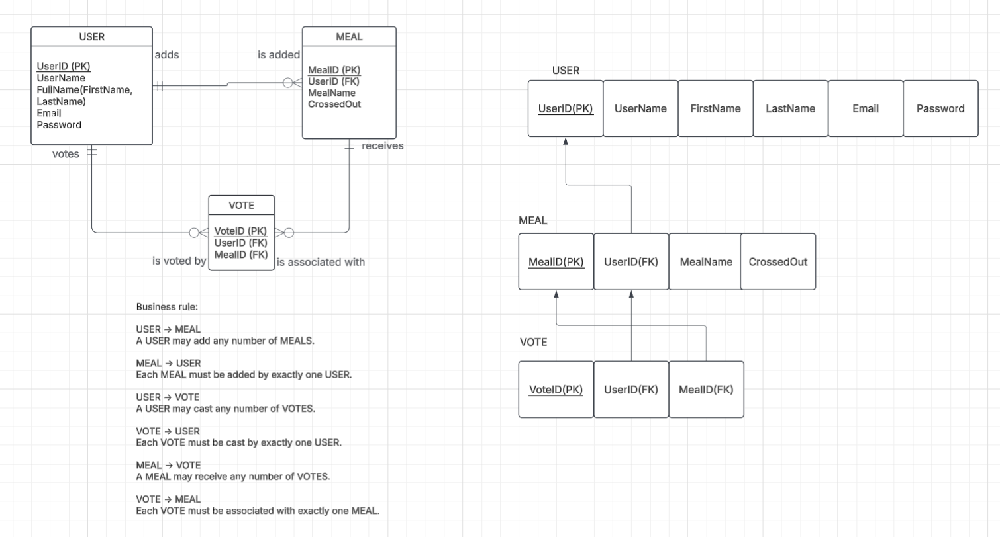

# Meal Picker

## Project Description

Meal Picker is a web application that helps friends, roommates, family, or partners decide what to eat by voting on from different meal options.

## Purpose

The purpose of Meal Picker is to make choosing meal process easier and more enjoyable.

## Intended Users

The intended users are friends, roommates, family members, partners, or can be anyone who wants help deciding what to eat.

## Features

- Register and log in
- Add meal ideas
- Delete meal ideas
- Cross out meal ideas
- Vote for meal ideas
- Randomly select a meal from the voted meal ideas

## Relations Diagram

The relations diagram shows the relations, entities, attributes, business rules.
Additionally, this ERD shows the normalization concepts to reflect the lecture contents from lecture 6.

## Business Rules

### USER and MEAL

USER may add any number of MEALS.
Each MEAL must be added by exactly one USER.

### USER and VOTE

USER may cast any number of VOTES.
Each VOTE must be cast by exactly one USER.

### MEAL and VOTE

MEAL may receive any number of VOTES.
Each VOTE must be associated with exactly one MEAL.