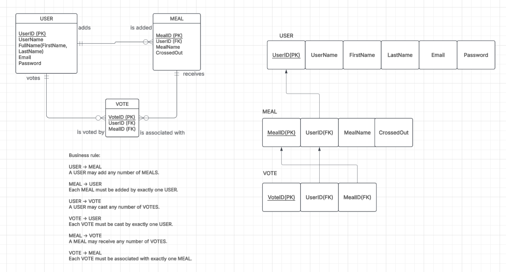

# Meal Picker

## Project Description

Meal Picker is a web application that helps friends, roommates, family, partners etc decide what to eat by voting on different meal options.

## Purpose

The purpose of Meal Picker is to make the process of choosing a meal easier and more enjoyable.

## Intended Users

The intended users are friends, roommates, family members, partners, or anyone who wants help deciding what to eat.

## Features

- Register and log in
- Add meal ideas
- Delete meal ideas
- Cross out meal ideas
- Vote for meal ideas
- Randomly select a meal from the voted meal ideas

## Relations Diagram

The relations diagram shows the relationships, entities, attributes, and business rules. Additionally, this ERD shows the normalization concepts to reflect the lecture contents from Lecture 6.

## Business Rules

### USER and MEAL

- A USER may add any number of MEALS.
- Each MEAL must be added by exactly one USER.

### USER and VOTE

- A USER may vote any number of VOTES.
- Each VOTE must be cast by exactly one USER.

### MEAL and VOTE

- A MEAL may receive any number of VOTES.
- Each VOTE must be associated with exactly one MEAL.

## Database Implementation

### Database System

MySQL was used as the relational database management system for this project.

### Tables

Two related tables were implemented for this assignment:
Later, I am planning to add VOTE entity.

**1. User**

The `User` table stores user account information.

- `user_id`: Primary key; automatically generated unique identifier.
- `username`: Username; required and unique.
- `email`: Email address; required and unique.
- `password`: Password field; required.
- `first_name`: User's first name; required.
- `last_name`: User's last name; required.

**2. Meal**

The `Meal` table stores meal ideas added by users.

- `meal_id`: Primary key; automatically generated unique identifier.
- `meal_name`: Name of the meal; required.
- `user_id`: Foreign key referencing `User.user_id`; required.
- `crossed_out`: Indicates whether the meal has been crossed out. Defaults to `FALSE`.

### Relationship

The `User` and `Meal` tables have a one-to-many relationship. One user may add multiple meal ideas, while each meal must be associated with exactly one user.

The foreign key `Meal.user_id` references `User.user_id` to maintain referential integrity.

### SQL Schema

The SQL statements used to create the database and tables are available in [`schema.sql`](schema.sql).

### Screenshots

- [Table Creation and Definitions](database/screenshots/table_creation.png)
- [SHOW TABLES Output](database/screenshots/show_tables.png)
